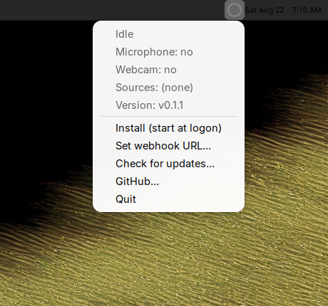
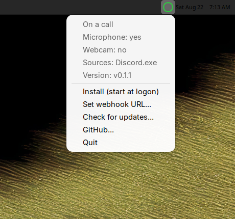
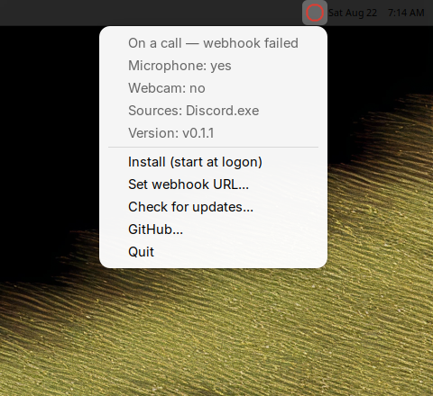
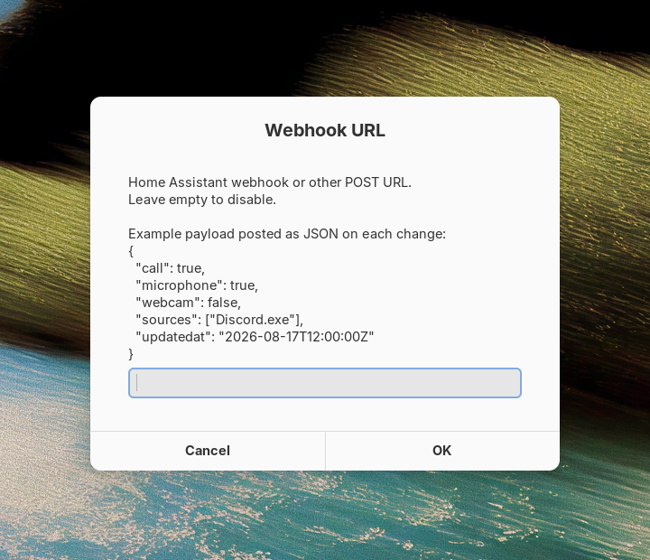

# Linux

The icon is a [StatusNotifierItem](https://www.freedesktop.org/wiki/Specifications/StatusNotifierItem/). KDE Plasma and many status-notifier hosts show it natively. GNOME needs an AppIndicator / StatusNotifier extension. Dialogs use `zenity` or `kdialog` when present (install one for Install / webhook prompts). Left-click can also open a zenity list if the host does not show the D-Bus menu.

Right-click the ring for the same menu as [Windows](../README.md#tray-icon) and [macOS](macos.md).

| Idle | On a call |
|------|-----------|
|  |  |

**Set webhook URL...** (zenity):

Same gray / green / red ring: idle, on a call, webhook failed. An up-chevron on the ring means a newer release is available; **Install update** replaces the installed file. See the [main README](../README.md#tray-icon).
